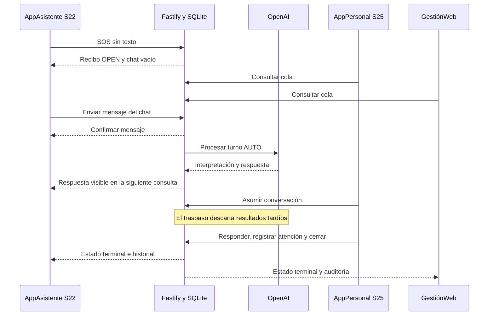

# Flujo actual de Discoprotect

La [rama final](checkpoints/final-acceptance.md) contiene H8.2–H10. GestiónWeb permite seleccionar o crear el evento, configurar sus horarios, recinto y guardias, gestionar incidentes, consultar estadísticas y publicar promociones ficticias. En **Entradas** emite o revoca una entrada y puede validar un código de forma manual. En **Búsqueda** consulta incidentes, zonas, guardias autorizados y entradas por ID.

En AppAsistente, **Servicios** comparte la selección con **Inicio**. Allí se presenta la entrada QR, se acepta o deshace un vínculo de acompañante y se consultan las promociones vigentes. En AppPersonal, **Inicio** muestra la atención asignada y las solicitudes prioritarias. **Incidentes** reúne la cola y el historial. **Herramientas** da acceso al lector NFC, al control de entradas, al recinto y a la búsqueda autorizada. **Perfil** reúne cuenta, conexión, evento y diagnósticos. El guardia asignado puede consultar los nombres de acompañantes desde el detalle de su atención activa.

En un turno que contiene una referencia visual inequívoca, Fastify actualiza de inmediato la ubicación probable y la evidencia. El trabajador independiente prepara el diálogo y las propuestas analíticas. Una señal local crítica actualiza el despacho antes del proveedor y el guardia conserva la posibilidad de revisar peligro y ubicación. Consulta [el guion final](demo-final.md) para el recorrido completo.

Discoprotect es un prototipo universitario de gestión de incidentes en eventos masivos. H7–H7.3 se integraron a `main` en el merge `8f5439e` con 6/6 comprobaciones físicas del flujo principal aprobadas. H8.1 se integró en `72774a7`. [PR #7](https://github.com/sebasaezz/prototipo-discoprotect/pull/7) · [PR #8](https://github.com/sebasaezz/prototipo-discoprotect/pull/8)

## 1. Componentes y acceso a datos

| Componente | Función |
| --- | --- |
| AppAsistente, Galaxy S22 | Verifica una cuenta ficticia, mantiene su credencial NFC y permite editar su ficha y contactos. Crea solicitudes SOS, conversa, cancela solicitudes activas y consulta el historial propio. |
| AppPersonal, Galaxy S25 | Lee NFC y resuelve fichas con autorización. Consulta la cola, muestra **Mi atención activa**, abre el chat en una pantalla dedicada y permite asumir, iniciar y cerrar la atención. |
| GestiónWeb | Resume la operación del evento autorizado y muestra cola, historial, prioridades y auditoría para su organizador. Permite retirar solicitudes y, en modo demo habilitado, purgarlas. |
| Fastify y SQLite | Fastify valida contratos, sesiones y membresías. SQLite conserva cuentas, fichas, contactos, credenciales NFC, eventos, zonas, hashes de sesiones, incidentes, mensajes, clasificaciones, operaciones y auditoría. |
| OpenAI | Recibe contexto ficticio filtrado desde un trabajador de Fastify para interpretar mensajes y generar respuestas. Fastify conserva la autoridad sobre estados, permisos y prioridad efectiva. |

Los tres clientes usan REST `/api/v1` con Bearer en memoria. El navegador usa el proxy de Vite en desarrollo. El asistente consulta su ficha, sus contactos y sus incidentes. Un guardia miembro puede consultar los incidentes y chats del evento, incluido un chat aún sin asignar. Solo el guardia asignado puede escribir como personal o registrar correcciones operativas. El organizador miembro puede consultar el resumen y las transiciones en el evento. El hilo completo se sirve al titular y a guardias autorizados. El relato original del triaje histórico solo aparece en el detalle para personal. [Contrato API](api-contract.md)

## 2. Del SOS al cierre

1. En **Inicio**, el asistente elige el evento autorizado y activa **Pedir ayuda · SOS**. Puede mantener el botón durante 1,5 segundos o usar su acción accesible y confirmar en el diálogo.
2. AppAsistente envía `mode: "SOS"` con un UUID generado por el cliente para ese envío. Fastify guarda el incidente `OPEN` y su conversación en una transacción. Devuelve el ID y la fecha de emisión sin esperar a OpenAI. El ID aparece en las próximas consultas de AppPersonal y GestiónWeb.
3. AppAsistente abre el chat del mismo incidente al confirmar el recibo. La conversación empieza vacía y muestra «Solicitud recibida. A la espera de información o atención del personal». Al pulsar **Enviar**, el texto se guarda como un mensaje del mismo chat. Un saludo como «hola» activa un turno de IA si el control sigue en `AUTO`.
4. Fastify encola cada mensaje elegible del asistente en `AUTO`. Tras analizarlo, puede actualizar la prioridad y la ubicación sugerida y publicar una respuesta visible, identificada como **Asistente IA**.
5. El guardia elige **Asumir conversación**. Una transacción asigna el incidente, registra el actor y cambia el control del chat a `STAFF`. La restricción de SQLite limita a una asignación activa por guardia entre todos los eventos. Otro intento de asumir devuelve `409 GUARD_ALREADY_BUSY`.
6. El guardia usa el mismo chat y registra con motivo la prioridad, la evaluación del peligro o la ubicación confirmada. **Iniciar atención** registra por separado el comienzo de la atención. AppPersonal ofrece **Cerrar solicitud** con motivo y confirmación. La API conserva **resolver** para el flujo H6.
7. El asistente puede cancelar incluso después de la asignación. El organizador puede retirar administrativamente una solicitud activa con motivo. Una acción terminal cierra el chat, libera la asignación activa y mueve la solicitud al historial con sus mensajes y auditoría.



### Estados y actores

| Estado resultante | Transición autorizada | Control del chat |
| --- | --- | --- |
| `OPEN` | El asistente miembro crea la solicitud. | `AUTO` |
| `ASSIGNED` | Un guardia miembro y disponible asume un `OPEN`. | `STAFF` |
| `IN_PROGRESS` | El guardia asignado inicia la atención desde `ASSIGNED`. | `STAFF` |
| `RESOLVED` | El guardia asignado resuelve desde `IN_PROGRESS` por la ruta H6. | `CLOSED` |
| `CANCELLED` | El asistente titular cancela desde `OPEN`, `ASSIGNED` o `IN_PROGRESS`. | `CLOSED` |
| `CLOSED` | El guardia asignado cierra con motivo desde `ASSIGNED` o `IN_PROGRESS`. | `CLOSED` |
| `WITHDRAWN` | El organizador miembro retira con motivo desde cualquiera de los tres estados activos. | `CLOSED` |

El estado `CLOSED` del chat indica solo lectura para cualquier resultado terminal. La auditoría conserva el actor, la fecha y la transición. La desaparición de la cola activa se refleja en las siguientes consultas.

## 3. Turnos de IA, prioridad y ubicación

Fastify registra las señales locales al guardar el mensaje. Si el turno requiere análisis semántico, el trabajador reserva en SQLite un trabajo por secuencia y llama a Responses API fuera de la transacción. Envía contexto reciente filtrado, hechos acumulados y referencias del evento. El modelo devuelve citas, categoría, prioridad, ubicación, incertidumbre, resumen y propuestas de reconocimiento y tema de pregunta. El servidor incorpora frases breves de reconocimiento y apoyo del modelo, decide si corresponde una pregunta y conserva la redacción de los protocolos de primeros auxilios.

El chat admite hasta 60 llamadas reservadas por incidente de forma predeterminada. `CHAT_AI_DAILY_LIMIT` permite un presupuesto UTC independiente. Una instalación que omite ese ajuste conserva la cuota compartida anterior. Ante timeout, proveedor desactivado, error, entrada filtrada, respuesta inválida o cuota agotada, Fastify conserva el incidente, registra el motivo y usa una respuesta local en `AUTO`. Si ya publicó orientación urgente para el turno, conserva esa respuesta. Las actualizaciones del modelo requieren que el incidente siga abierto con la misma versión.

Las señales locales de falta de respuesta, respiración anormal, sangrado grave, convulsiones en curso, incendio, violencia, aplastamiento o peligro explícito para varias personas pueden elevar a P0 al guardar el mensaje. El desmayo sin otra señal recibe atención provisional P1. Un mensaje trivial deja vigente la evidencia crítica. Las revisiones humanas pueden resolver el peligro observado y una señal crítica posterior abre una nueva evaluación. El sistema registra las contradicciones como asuntos por verificar.

### Orientación de emergencia

`CL-PRIMERA-RESPUESTA-2025-v1` prioriza la seguridad de la escena y pedir ayuda. En una emergencia médica aconseja llamar al SAMU al 131. Cuando el relato indica respiración ausente o anormal, la pauta de RCP se aplica si es seguro acercarse y la persona tampoco responde. Incluye seguir al operador y usar un DEA disponible. Para niños y lactantes reconoce el papel de las ventilaciones y remite al operador para adaptar la técnica. Cuando la edad es desconocida, pide informarla al operador. Para sangrado externo grave ofrece presión directa si es seguro. Para convulsiones y otros peligros activa la orientación de ayuda correspondiente. El texto del protocolo se genera en el servidor y su identificador queda registrado.

Fuentes de la pauta. [AHA BLS adultos 2025](https://cpr.heart.org/en/resuscitation-science/cpr-and-ecc-guidelines/adult-basic-life-support/) · [AHA/AAP BLS pediátrico 2025](https://cpr.heart.org/en/resuscitation-science/cpr-and-ecc-guidelines/pediatric-basic-life-support) · [AHA y American Red Cross primeros auxilios 2024](https://cpr.heart.org/en/resuscitation-science/2024-first-aid-guidelines) · [SAMU 131, Gobierno de Chile](https://www.gob.cl/noticias/estas-fiestas-patrias-no-olvides-numeros-emergencia/)

Las reglas locales son heurísticas sobre texto en español y pueden abstenerse ante relatos ambiguos o filtrados. La pauta es breve, orientada a una persona que solicita ayuda en un recinto. Los síntomas, la edad y el entorno requieren verificación. El operador adapta la orientación. El prototipo académico carece de integración de despacho externo.

Al confirmar una respuesta, Fastify vuelve a comprobar en SQLite que el incidente siga `OPEN` y que su versión operativa coincida con la reservada. Asumir o terminar el incidente invalida los trabajos pendientes y descarta el resultado que todavía esté en vuelo. Un mensaje nuevo del asistente antes del traspaso conserva su propio turno.

La **prioridad sugerida** procede del análisis. La **evidencia corroborada** exige una cita literal y una señal de peligro reconocida con comprobaciones locales de negación o resolución. La **decisión humana** se registra con motivo y revisión propia. Fastify calcula la prioridad efectiva:

- `P0` crítica, `P1` alta, `P2` media, `P3` baja y `PENDING` pendiente de evaluación. La cola ordena por `P0 → P1 → PENDING → P2 → P3`, luego por estado activo, antigüedad e ID.
- Una sugerencia `P0` con evidencia corroborada fija un piso crítico provisional. Una aclaración posterior de ubicación conserva ese piso. Un motivo histórico de peligro inmediato también fija un piso crítico. Una sugerencia crítica sin respaldo aporta `P1`.
- El guardia puede confirmar peligro (`CONFIRMED`) o registrar que fue descartado o superado (`CLEARED`). Retirar el piso permite aplicar la prioridad humana guardada o la sugerida vigente. La referencia a la evidencia queda en la auditoría.
- En `OPEN`, a los 120 s por defecto `P2` y `PENDING` pasan a `P1`, y `P3` pasa a `P2`. A los 300 s, `P3` pasa a `P1`. La escalada por espera termina al asignar y tiene techo `P1`.

La ubicación distingue lo declarado por el asistente, la zona probable sustentada por el catálogo y la corrección verificada por el guardia. La última hipótesis vigente conserva su cita y fecha. Los filtros y la corroboración son heurísticos. Usa datos ficticios y supervisión humana. Las respuestas se limitan a hechos del relato, preguntas pertinentes y las pautas de seguridad autorizadas.

## 4. Identificación NFC

AppAsistente verifica la cuenta, la sesión y la credencial activa con Fastify. El servicio HCE toma el ID opaco vigente de 16 bytes de un registro en memoria e intercambia por NFC el ID y los códigos de estado. La selección y la lectura deben corresponder a la misma generación. Cambiar de cuenta u origen, cerrar sesión o vencerla invalida la emisión anterior.

En el lector del S25, Reader Mode usa IsoDep para hacer SELECT y GET. AppPersonal cierra IsoDep antes de consultar `POST /api/v1/nfc/resolve`. Fastify comprueba la sesión del guardia y que ambas personas pertenezcan al evento autorizado antes de entregar ficha y contactos. La demo local requiere activación explícita y una nueva lectura. NFC identifica a la persona y el Bearer autoriza la consulta. El SOS y el chat se gestionan por HTTP y funcionan sin escaneo. [Contrato APDU y comprobaciones NFC](nfc-contract.md)

## 5. Administración de incidentes

### GestiónWeb H8.1

Al iniciar sesión con el PIN de organizador, GestiónWeb abre el **Dashboard** del evento autorizado. Con varias membresías de organizador, la cuenta selecciona uno de sus eventos. La barra lateral se convierte en un menú en pantallas pequeñas. El encabezado muestra nombre, recinto y estado del evento.

El Dashboard cuenta solicitudes **Activas**, **Sin asignar**, **Asignadas** y **En atención**. Hasta cinco solicitudes activas siguen el orden de despacho que entrega Fastify. El resumen comparte la consulta con **Incidentes** e indica la hora de la última respuesta correcta. Si falla la conexión, los datos disponibles se marcan como la última consulta. Si el servidor rechaza el acceso al evento, la vista descarta sus solicitudes.

**Personal**, **Estadísticas**, **Anuncios y promociones**, **Entradas** y **Búsqueda** usan el mismo contexto de sesión y evento. Al cambiar de contexto se cancelan las lecturas y se limpia el estado local de los comandos. Cambiar de sección dentro del mismo evento permite volver a una confirmación de incidentes o reintentar una operación incierta con el mismo comando.

### Recinto y zonas H8.2

1. En GestiónWeb abre **Recinto y zonas**. Edita el evento y el recinto, completa las referencias físicas de acceso y atención y guarda. Comprueba el mensaje de confirmación y recarga para verificar persistencia.
2. Crea la zona **Entrada principal** y escribe «Hay un stand de mote con huesillo junto a un letrero amarillo». Guarda y recarga. Puedes asociar un punto médico con referencia «Sector norte».
3. En AppAsistente, selecciona el mismo evento, envía un SOS y escribe «Estoy al lado del estand de mote con huesillo». En una demo ficticia con el chat IA habilitado, consulta la ubicación probable. Para una revisión sin llamadas externas, configura `TRIAGE_ENABLED=false` y `CHAT_AI_ENABLED=false`. Ejecuta `npm test` desde `backend/` para reproducir la inferencia con el proveedor simulado.
4. En AppPersonal, abre la solicitud y comprueba **Ubicación declarada**, **Ubicación probable**, **Motivo** y **Estado de la inferencia**. Asume la solicitud y registra una ubicación verificada. La ubicación confirmada prevalece en el despacho. Puedes desactivar la zona en GestiónWeb y abrir otra vez **Ver recinto y puntos operativos** para comprobar que desaparece del catálogo activo y se conserva en el análisis anterior.

Los filtros heurísticos pueden omitir textos que parezcan contener datos personales o instrucciones. El reconocimiento se abstiene con señas genéricas, dos zonas con respaldo parecido o una paráfrasis que carece de coincidencias suficientes. GestiónWeb y AppPersonal muestran la ubicación probable desde que se acepta la evidencia. La ubicación se refina con nuevas señas y la verificación en terreno del guardia prevalece. [Contrato de configuración](api-contract.md#recinto-y-zonas)

**Una comprobación integrada.** En la demo ficticia, registra **Entrada principal** con la seña «toro mecánico junto al portón». En el S22 envía un SOS y escribe «Hay alguien desmayado al lado del toro mecánico». Verifica en GestiónWeb y en el S25 la ubicación probable y en el S22 una pregunta sobre respiración. Responde «No» y luego «Aló». Verifica la orientación local, P0, la evidencia y la ausencia de preguntas repetidas. En el S25 asume y registra una ubicación verificada. Comprueba que prevalece en ambas vistas y que el guardia controla el chat.

### Cola, historial y acciones

En **Incidentes**, GestiónWeb separa **Cola activa** e **Historial**. **Retirar de la cola** exige un motivo y conserva el incidente con estado `WITHDRAWN`. Cancelar corresponde al asistente titular. Cerrar corresponde al guardia asignado.

En el evento ficticio `demo-festival`, **Eliminar definitivamente** selecciona un incidente y **Limpiar solicitudes demo** selecciona todos los incidentes del evento, incluidos los activos. La vista previa muestra la cantidad y devuelve una huella de la selección. El organizador confirma con `ELIMINAR`. Fastify crea un respaldo completo junto a la base en `demo-purge-backups/`, verifica integridad, claves foráneas y huella de la selección, y calcula su SHA-256, y aborta si la base cambió o falla el respaldo. La purga borra el incidente y sus dependencias en una transacción. Conserva cuentas, eventos, zonas, credenciales NFC y una auditoría separada de purga. Los tombstones ligan la cuenta y el UUID de cliente con la operación de purga. Un reenvío antiguo recibe `409 REQUEST_PURGED`. [Contrato de administración](api-contract.md#administración-y-purga)

## 6. Persistencia y sincronización

Fastify usa transacciones inmediatas para escrituras. El UUID de creación se deduplica por asistente y el UUID de mensaje por conversación. Las operaciones de personal y organizador usan versión esperada y UUID de operación. Un reenvío equivalente devuelve el resultado registrado y uno incompatible produce un conflicto. Las revisiones de ficha, triaje y despacho mantienen sus propias versiones.

Los listados visibles consultan aproximadamente cada cinco segundos y el chat abierto cada dos segundos. Ante fallos se espacian las lecturas hasta 30 segundos. El chat usa cursor por secuencia y reconcilia mensajes por ID y secuencia. Al recuperar la conexión, los clientes consultan la vista vigente. Las apps mantienen en memoria la clave y el cuerpo de un envío incierto para repetirlo; los registros ya confirmados se recuperan de SQLite al reiniciar. Un chat terminal conserva mensajes y rechaza escrituras nuevas. Un reenvío de un mensaje ya confirmado puede recuperar su recibo.

## 7. Despliegue local

Usa Node.js **22.16.0 o posterior** y npm. El manifiesto del backend declara 22.13.0, pero la ruta de purga habilitada invoca `node:sqlite.DatabaseSync.location()`, disponible desde 22.16.0. Para Android usa JDK 21, SDK Android 36 y el Gradle Wrapper 8.13. Configura `ANDROID_HOME` o `sdk.dir` en un `local.properties` local.

Desde `backend/`, copia `.env.example` a `.env` si todavía no existe. Elige una ruta SQLite nueva, por ejemplo `DATABASE_PATH=data/aceptacion-h73.sqlite`, y define PIN privados distintos para `DEMO_STAFF_PIN`, `DEMO_STAFF_2_PIN` y `DEMO_ORGANIZER_PIN`. Las cuentas privilegiadas correspondientes quedan deshabilitadas sin PIN. Desde esa carpeta:

```sh
npm ci
npm run db:seed
npm start
```

`db:seed` compila, aplica las migraciones 001–011 y agrega la demo. Arrancar Fastify también aplica las migraciones pendientes. Sobre una base anterior, trabaja primero en una copia consistente con Fastify detenido. La 008 detiene el arranque si un mismo guardia tiene varias asignaciones activas. Conserva los registros originales y requiere regularizarlas antes de reintentar. [Migraciones y persistencia](data-model.md)

En otra terminal, desde `web/`, ejecuta `npm ci` y `npm run dev`. Abre `http://127.0.0.1:5173`. Vite reenvía `/api/v1` al backend `http://127.0.0.1:3000`. Ajusta `DISCOPROTECT_API_ORIGIN` en el proceso de Vite si cambias el origen de Fastify.

Desde la raíz, ejecuta `./gradlew.bat :emitter:assembleDebug :reader:assembleDebug` en Windows o `./gradlew :emitter:assembleDebug :reader:assembleDebug` en Linux o macOS. Instala los APK debug en S22 y S25. Consulta sus rutas en el [README](../README.md#instalación-rápida). Selecciona `antonia`, `martin` o `sofia` en AppAsistente, `guardia` o `guardia2` en AppPersonal y usa el PIN de `organizador` en GestiónWeb. Selecciona el mismo evento.

| Configuración | Uso |
| --- | --- |
| `HOST`, `PORT`, `DATABASE_PATH` | Por defecto `127.0.0.1:3000` y `data/demo.sqlite` desde `backend/`. Para los teléfonos en la LAN controlada usa `HOST=0.0.0.0`, autoriza el puerto en la red privada y configura en ambos la URL con la IP LAN del PC. HTTP queda reservado a debug y datos ficticios. |
| `TRIAGE_ENABLED`, `CHAT_AI_ENABLED`, `OPENAI_API_KEY` | Controlan el triaje de solicitudes antiguas, el asistente del chat y la clave local. La plantilla desactiva ambos proveedores. Si una instalación antigua omite `CHAT_AI_ENABLED`, el chat hereda `TRIAGE_ENABLED`. |
| `OPENAI_CHAT_MODEL`, `OPENAI_MODEL` | Por defecto `gpt-6.1-sol` en el chat y `gpt-5.4-mini` en triaje histórico. El adaptador conversacional envía esfuerzo `low`. |
| `TRIAGE_DAILY_LIMIT`, `TRIAGE_MAX_QUEUE_AGE_MS`, `TRIAGE_TIMEOUT_MS`, `CHAT_AI_DAILY_LIMIT`, `CHAT_AI_MAX_QUEUE_AGE_MS` | Plantilla de 100 llamadas UTC por flujo, espera en cola de hasta 30.000 ms y timeout del triaje H7 de 5.000 ms. |
| `CHAT_AI_CONTEXT_BYTES`, `CHAT_AI_MAX_ZONES`, `CHAT_AI_RECENT_MESSAGES` | Presupuesto UTF-8 del JSON de 32.768 bytes, hasta 64 zonas y 16 mensajes recientes. Fastify prioriza el estado de la conversación y las zonas relevantes con su descripción completa. |
| `CHAT_AI_TIMEOUT_MS`, `CHAT_AI_MAX_OUTPUT_TOKENS`, `CHAT_AI_MAX_INCIDENT_CALLS` | Timeout de 30.000 ms, hasta 2.560 tokens de salida por respuesta y 60 reservas por incidente. |
| `CHAT_AI_DIAGNOSTICS` | Desactivado por defecto. Registra revisión y selección del catálogo, presupuesto de bytes, estado y consumo del proveedor y decisión de ubicación por turno. Registra identificadores y motivos sin copiar el texto de mensajes ni descripciones. |
| `FIRST_AID_ENABLED` | Activa las pautas de comprobación de respiración, RCP y DEA, o presión directa según el caso. El valor inicial es `true`. La detección y el aviso básico de emergencia funcionan con cualquier valor. |
| `DISPATCH_EARLY_SECONDS`, `DISPATCH_LATE_SECONDS` | Umbrales de despacho iniciales de 120 y 300 segundos. |
| `DEMO_PURGE_ENABLED`, `ALLOW_DEMO_RESET` | Ambas opciones empiezan en `false`. Habilita la purga solo para una base descartable y vuelve a desactivarla tras verificarla. El reset es una operación independiente de CLI que restaura las entidades de la demo. |

Para validar el entorno, consulta `GET /api/v1/health`. Continúa con el [guion físico vigente](h7-2-integration.md), el [checkpoint H7.3](checkpoints/h7-3-2026-11-17.md) y el [alcance de H8](roadmap.md#h8--administración-de-eventos-y-personal).
