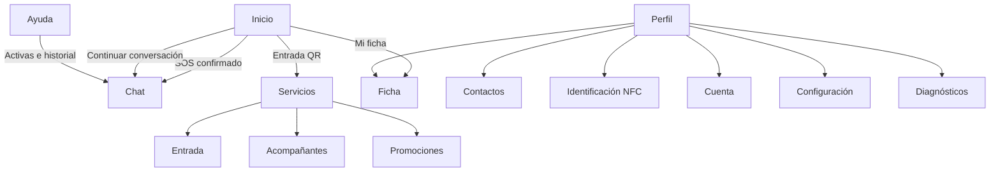

# AppAsistente · arquitectura UX de Fase 1

Base verificada: `b733020346cb6adfb5f37cbffc779271eba6b4bc` (H10).

## Inventario y reubicación

| Pantalla actual | Funciones y estados existentes | Destino |
| --- | --- | --- |
| Identificación | Credencial de cuenta, hardware, ajustes NFC e instrucciones de lectura | Perfil → Identificación NFC |
| Identificación | Estado técnico, Secure NFC, HCE, actualización e ID de demo | Perfil → Diagnósticos NFC |
| Conexión | Dirección Fastify, comprobación y cambio de origen | Perfil → Configuración |
| Conexión | Elección, verificación, cambio de cuenta y cierre | Perfil → Cuenta |
| Mi ficha | Lectura, edición, actualización, conflicto y resultado incierto | Perfil → Mi ficha, con acceso desde Inicio |
| Contactos | Alta, edición, eliminación y revisión de versión | Perfil → Contactos de emergencia y acceso desde Mi ficha |
| Chat de ayuda | Evento autorizado, SOS de 1,5 s, confirmación accesible y reintento | Inicio |
| Chat de ayuda | Solicitudes activas, historial y cancelación | Ayuda |
| Chat de ayuda | Hilo, autoría, estado, envío y reintento | Ayuda → Conversación |
| Servicios | QR, código manual, consumo, revocación y vencimiento | Servicios → Entrada QR, con acceso desde Inicio |
| Servicios | Invitación, aceptación, consentimiento y desvinculación | Servicios → Acompañantes |
| Servicios | Promociones vigentes y enlaces permitidos | Servicios → Promociones |
| SOS y Servicios | Selección autorizada del evento | Inicio y Servicios, con una selección compartida |

La fila inicial de seis chips pone diagnósticos, edición y ayuda al mismo nivel. El chat aparece junto con el formulario, los detalles del incidente y el historial dentro del mismo desplazamiento. En Servicios, los filtros y las acciones de actualización preceden a la entrada.

## Navegación

El controlador conserva un destino único. Inicio y Ayuda comparten el contexto y polling SOS. La conversación es un subdestino de Ayuda, asociado a un incidente devuelto por Fastify. Retroceso vuelve a Ayuda desde el hilo y a Perfil desde sus subdestinos. La edición ocupa la pantalla y conserva su confirmación de salida. Los cuatro destinos principales muestran navegación inferior.

## Pantallas y estados

- **Inicio.** Encabezado corto, contexto de evento y sesión, control SOS destacado y accesos a QR y ficha. Sin sesión dirige a verificar cuenta. Sin evento explica el requisito y muestra la selección autorizada. Un incidente activo prioriza continuar la conversación. Un intento pendiente permite recuperar el mismo envío. El SOS recuperado abre el hilo solo después de recibir confirmación.
- **Ayuda.** Solicitudes activas primero e historial aparte. Permite consultar, continuar o cancelar según el estado confirmado. Si está vacío, dirige a Inicio. La conversación tiene encabezado de estado, detalles secundarios, lista perezosa alineada por autor y compositor sobre el teclado. AUTO, IA no disponible, STAFF, cierre, desconexión y envío incierto tienen mensajes propios. El desplazamiento acompaña las respuestas mientras el lector está al final.
- **Servicios.** Contexto de evento y acceso prioritario a la entrada. Acompañantes y promociones se ubican en el mismo destino. Cada panel mantiene su validación, errores y acciones. Seleccionar otro evento es explícito y queda bloqueado mientras se reconcilia un SOS. Al regresar al evento anterior se recupera su última lista y se consulta la vigente.
- **Perfil.** Una vista de accesos agrupa datos de emergencia, identificación, cuenta, configuración y diagnósticos. Cuenta concentra la verificación y el cierre. Configuración contiene la dirección y conectividad. Las pantallas de datos mantienen carga, ficha no disponible, dato desactualizado, edición y revisión de conflictos.

## Riesgos técnicos

- Inicio y Ayuda deben habilitar el mismo ámbito de lectura y escritura SOS. Cambiar entre ambos conserva el polling. Las lecturas de otros eventos se cancelan antes de publicar una nueva selección.
- La conversación se abre con un recibo de creación validado. Una cancelación confirmada conserva su significado y destino. La sesión y el evento se verifican al consultar y enviar, antes de aceptar respuestas tardías.
- Un borrador de conversación se guarda en memoria de la sesión por incidente. El reintento usa la misma clave y texto. Un cambio de cuenta, servidor o vencimiento limpia los datos visibles y los borradores de chat.
- La presentación del hilo tiene una variante de AppAsistente. Comparte carga, estados y deduplicación con AppPersonal. Deben compilar y probarse ambos APK.
- Los controles de edición y publicación HCE se conservan. Verificar por separado suites JVM, capturas Android y lectura NFC física.
