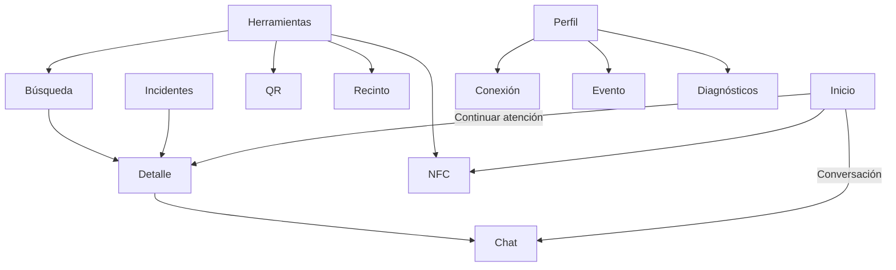

# AppPersonal · arquitectura UX de Fase 2

La rama parte de `bd9c832`, con H10 integrado en `b733020` y la identidad de ambas aplicaciones conservada en `4072e70`.

## Inventario y transición

| Antes | Después | Estado y operaciones |
| --- | --- | --- |
| Configuración inicial del lector | Perfil → Conexión y cuenta | Dirección, salud, PIN en memoria, guardia autorizado, expiración y reintento |
| Evento y sesión dentro de configuración y cola | Perfil → Evento | Membresías, selección explícita, recinto y cierre de sesión |
| Lector como entrada principal | Inicio → Leer identificación NFC o Herramientas → NFC | Adaptador, lectura, ficha, nueva lectura, errores y demo explícita |
| Diagnósticos dentro del lector | Perfil → Diagnósticos NFC | Estado del adaptador y última lectura de la visita al lector |
| Cola con lista y detalle en la misma pantalla | Incidentes → Detalle | Orden Fastify, estado, despacho, acciones, triaje y acompañantes |
| Atención dentro de la cola | Inicio → Continuar atención | Asignación confirmada, tiempo, prioridad, ubicación y acceso al hilo |
| Chat dentro de la pantalla de incidentes | Detalle o Inicio → Conversación | Hilo paginado, autoría, borrador y reintento vinculados a la sesión |
| Enlace conjunto a herramientas H9 | Herramientas → Recinto, QR, Búsqueda | Cámara, código manual, validación idempotente, zonas, puntos y filtros |

## Navegación y estados

La barra inferior, la superficie clara, los iconos lineales, las tarjetas y el compositor fijo siguen el [blueprint de AppAsistente](appasistente-layout-plan.md). Sus accesos SOS se traducen en atención ya asignada, cola priorizada y lectura NFC. El encabezado conserva el banner oficial.

- **Inicio.** Muestra evento, cuenta y conectividad. Presenta la atención activa o un estado vacío tras recibir la cola. Resume P0 y P1 a partir de la respuesta de Fastify. Sin contexto autorizado dirige a configuración.
- **Incidentes.** Mantiene el orden del servidor dentro de cada grupo de estado. El detalle abre primero prioridad, ubicación, situación y acciones. Los datos técnicos quedan al final. Las ubicaciones conservan su fuente.
- **Chat.** Reutiliza el motor compartido de polling, recibos y reintentos. Usa el mismo lenguaje visual de burbujas con identificación del propio guardia, otros autores de seguridad, asistente e IA. El teclado mantiene accesible el compositor.
- **Herramientas.** NFC exige contexto explícito de lectura. H9 conserva las solicitudes y resultados correspondientes a su sesión y evento.
- **Perfil.** Separa conexión y cuenta, evento y diagnóstico. Distingue la demo local. Las transiciones de cuenta y evento validan el contexto pendiente.

## Contrato del controlador y riesgos

La sesión, el evento y la cola residen en `ReaderController`. Los destinos visuales comparten ese estado. La navegación preserva la consulta de cola, el comando pendiente y la asignación. El contexto de escaneo es explícito y su trabajo se cancela al salir; el trabajo de cola tiene su propia generación. La actividad conserva Reader Mode y el cierre de IsoDep en el lector. Los resultados de otro evento, sesión o lectura quedan invalidados. La demo sigue requiriendo activación y una nueva lectura.

La cola distingue actualización, error y última lectura; un fallo de autorización invalida los datos del evento. El chat y el despacho usan las validaciones existentes. Los borradores y claves de reintento viven en memoria. Las revisiones operativas conservan la versión y los motivos exigidos.

## Criterios de aceptación

1. Acceso directo a la atención activa, al mismo hilo y al lector NFC. Atrás vuelve al contexto de origen.
2. Fastify confirma las acciones operativas y fija la prioridad. Navegar mantiene evento, sesión y asignación.
3. Una lectura que empezó dentro del lector no publica su resultado tras salir. El modo demo permanece identificado.
4. El guardia propio escribe a la derecha; asistentes, IA y otros autores a la izquierda. El estado cerrado es de solo lectura.
5. Validar ambos APK y las suites Android. Inspeccionar capturas de antes, primera implementación y corrección, también a 320 dp con fuente ampliada. Registrar por separado la aceptación física.
